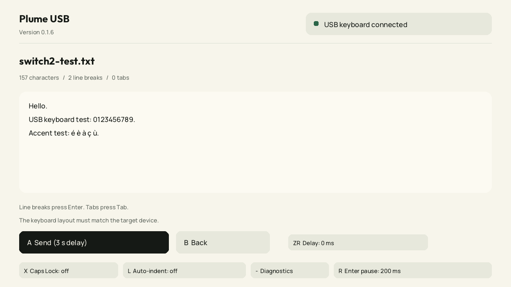

# Plume USB 0.1.6

Nintendo Switch 1 homebrew that sends `Hello` or a text file as USB keyboard input.

[Download v0.1.6](https://github.com/MichelSama/plume-usb/releases/tag/v0.1.6): use the `.nro` to update an existing installation, or the SD ZIP for a complete installation.



## Changes in 0.1.6

- Separate Enter timing for text fields that miss short newline key presses. Default: 50 ms with all keys released before Enter, at least 50 ms holding Enter after its USB acknowledgement, then a 200 ms pause after the release acknowledgement. Character delays stay independent.
- In the file preview, press R or tap `Enter pause` to cycle 200, 400, 800, 0 and 100 ms. The setting is saved. 0 disables special Enter timing. At 100 ms or above, the neutral and hold durations stay at least 50 ms. Longer selected character delays are retained.
- This is intended to improve missed newlines; target editor acceptance still requires a hardware test. Start with 200 ms, then try 400 or 800 ms if newlines are still missing. No duplicate Enter presses are inserted.

## Changes in 0.1.5

- English interface and shorter, descriptive labels.
- Caps Lock button and X shortcut. Sends a single Caps Lock key press to the connected device, then releases it. The displayed state comes from the host: `on`, `off`, or `unknown` if the host has not reported its keyboard LEDs.
- USB diagnostics now use the minus (-) shortcut.
- Delays are displayed directly in milliseconds: 80, 40, 10, 2, 0 and 160 ms. Existing saved settings keep their meaning.

Caps Lock never blocks text input. The app does not automatically change or compensate for it; the final letter case depends on the target's state. The manual toggle is available while no text is being sent.

## Installation and first test

Extract the SD archive at the root of the Switch 1 SD card. For an update, replacing this file is enough:

```text
sdmc:/switch/plume-usb/plume-usb.nro
```

1. Launch Plume USB from hbmenu under Atmosphere. Application mode (hold R while launching a game) is recommended.
2. Connect the Switch 1 USB-C port to a USB host. For a Switch 2 test, use a USB-A to USB-C data cable from the target dock to the Switch 1. Direct USB-C connections depend on role negotiation.
3. Open a text field on the target that accepts a USB keyboard.
4. Match the app's AZERTY FR or QWERTY US layout to the target keyboard setting.
5. Wait for `USB keyboard connected`, select `Send Hello`, then press A in the preview. Sending starts after three seconds. No Enter key is added.
6. Check the target text. Press X to toggle Caps Lock if needed. Press - for USB diagnostics.

The connected status requires USB configuration and the completed HID descriptor exchange. Successful USB reports do not prove that the target text field accepted the characters. Earlier builds have been used to type on a Switch 2; missing newlines were reported at 0, 2 and 10 ms. Version 0.1.6 has been compiled and tested locally; its new Enter timing still needs testing on the consoles.

## Text files and delays

Select any `.txt` file on the SD card. The `texts` folder in the package contains examples. Files are read without modification.

- UTF-8, with or without BOM; maximum size 256 KiB.
- The entire file is checked before sending. Invalid UTF-8 or an unsupported character stops preparation and reports its position. Nothing is silently substituted.
- US layout supports printable ASCII, line breaks and tabs.
- French layout also supports `é è ç à ù â ê î ô û ä ë ï ö ü € £ ° µ`. Composed accents require the target to handle dead keys. Emoji, curly quotes, `œ`, accented capitals and decomposed Unicode accents are unsupported.
- CRLF, CR and LF each produce one Enter key. Tabs produce Tab. The app adds no trailing Enter; a trailing line break present in the file is sent.
- The preview shows the first lines and up to 1,023 bytes. Sending uses the entire file.
- ZR cycles through 80, 40, 10, 2, 0 and 160 ms. The delay applies separately to key down and key up. Enter uses the separate timing described above unless Enter pause is 0. Every USB report must finish before the next report is submitted, including at 0 ms. Repeated letters retain a release between presses.
- Actual speed depends on the USB host and text field. Increase the delay if characters are missing. The app cannot detect characters ignored by the target application after USB completion.
- A disconnect or failed transfer stops sending. B cancels and attempts to release all keys. There is no automatic retry of the text.

## Auto-indent compensation

In the preview, press L or tap `Auto-indent` to enable compensation when the target editor copies the previous line's indentation after Enter. It is off by default and the setting is saved.

With compensation enabled, Plume USB sends one internal Backspace for each leading space or tab on the previous line, after Enter and its pause. It then types the next line exactly as supplied in the file. Mixed spaces and tabs are counted too. Literal Backspace control characters (U+0008) in files are rejected during preflight, regardless of this setting.

This assumes the editor copies spaces/tabs literally and each Backspace deletes one character. Editors that expand tabs into spaces, add indentation after syntax such as block openers, or erase multiple spaces per Backspace need different handling. Test a short indented sample in the target editor before using compensation on a full file. The app cannot read back the target editor's contents.

## Controls

| Control | Action |
| --- | --- |
| Up / Down | Select an action or file |
| A | Open, confirm or start sending |
| B | Back, parent folder or cancel sending |
| L / R | Previous / next file page |
| Y | Switch AZERTY FR / QWERTY US |
| ZR | Change character delay |
| R in preview | Change Enter pause |
| L in preview | Toggle auto-indent compensation |
| ZL | Switch light / dark theme |
| X | Toggle Caps Lock on the target |
| - | USB diagnostics |
| + | Exit |

On-screen buttons and file rows also support touch. Layout, character delay, Enter pause, auto-indent compensation and theme are saved to the SD card. Controls that would interfere with an active transfer are locked until it finishes.

## Diagnostics

Press - to open diagnostics and A to reset USB. Close other USB or MTP homebrew before testing. If the connection fails, try reconnecting the cable and resetting USB. A PC with a text editor can also serve as a target for a separate test.

Log file:

```text
sdmc:/switch/plume-usb/usb.log
```

The log records USB requests, transfer results, resets and error stages. Text file contents are not logged. Opening or resetting USB replaces the previous log. When reporting a problem, include this log, Horizon/Atmosphere versions, launch mode, cable connection and what appeared in the target text field.

## Building and tests

Requires Python 3, devkitPro, devkitA64, libnx and switch-tools:

```text
python build.py
```

The build uses `C:/devkitPro` on Windows or `/opt/devkitpro` elsewhere. Set `PLUME_DEVKITPRO` for another location. Output: `build/plume-usb.nro`. Fonts and icon are included; the build needs no downloads.

The app uses Horizon OS 5.0.0+ `usb:ds`, with a boot keyboard interface, interrupt IN endpoint 0x81, 8-byte input reports and a 63-byte report descriptor. Keyboard LEDs are received via control SET_REPORT. Caps Lock uses HID key usage 0x39. USB control IN data completes before receiving the OUT status stage. `test_file.c` also checks an external text file through the actual converter and typing scheduler at 0, 2 and 10 ms with simulated USB latency, comparing every key and counting Enter presses. It only reads the file as data.

The experimental local USB identifier is `1209:0001`.

Portable tests are in `tests/`: text encoding and preflight, touch routing, typing delays and report acknowledgement, mocked USB requests and errors, LED state and resets. `preview.c` renders screens using the application's renderer and embedded fonts. These tests do not simulate the real Horizon USB service or target console.

On Windows, run `tests\run-tests.cmd` from a Visual Studio x64 Native Tools prompt after building. The optional external-file test can be compiled and run with:

```text
cl /nologo /std:c11 /O2 /D_CRT_SECURE_NO_WARNINGS /Iinclude /Febuild\test_file.exe /Fobuild\ tests\test_file.c source\text.c source\typer.c
build\test_file.exe path-to-your-file.txt
```

Application code: MIT. Embedded stb_truetype, libnx and Manrope/Outfit fonts retain their included licenses.
